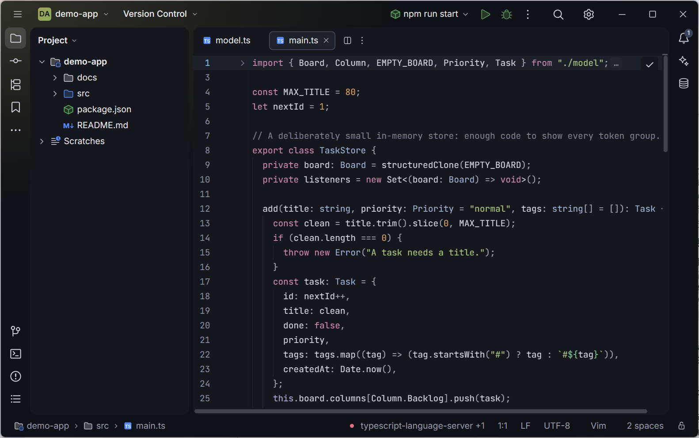
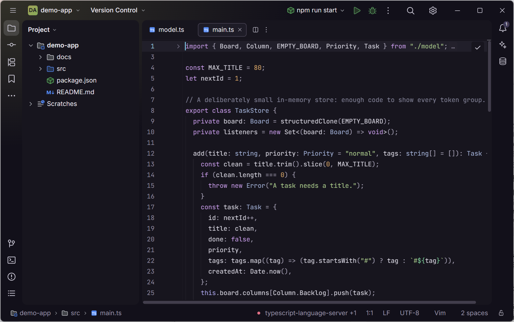
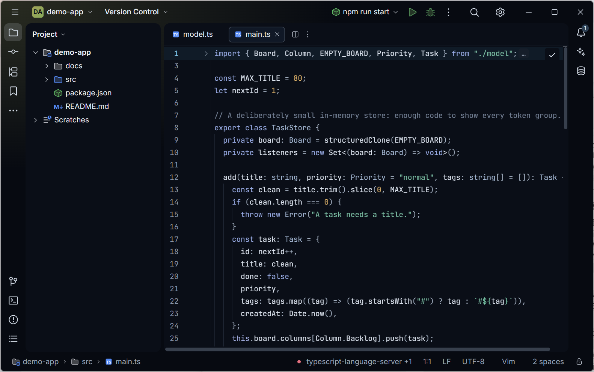
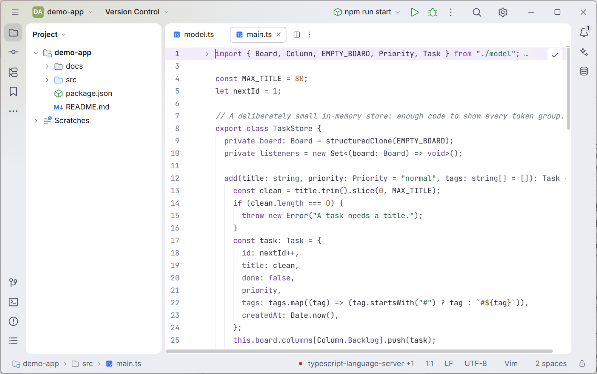

# Nebula Aura Theme for OpenIDEA

A data-only colour theme plugin for OpenIDEA. It adds four themes to
_Settings › Plugins_ and applies them as design-token overrides; it ships no
WebAssembly, asks for no capability and runs no code.

| Theme | `kind` | Character |
|---|---|---|
| Nebula Aura Dark | `dark` | Neutral cool-grey surfaces, blue-violet accent, muted syntax palette |
| Nebula Aura Violet | `dark` | The same structure with a violet-tinted accent and slightly warmer syntax |
| Nebula Aura Midnight | `dark` | Deepest blue-black base, teal-leaning accent, highest surface separation |
| Nebula Aura Light | `light` | Near-white layered surfaces, pale violet selection, neutral borders |

## What it themes

- **UI:** all 117 tokens of `src/styles/tokens.css` — surfaces, lines, text,
  states, gutters, search, VCS, status and terminal colours.
- **Editor:** all 107 tokens of the editor colour scheme — syntax groups,
  caret, line numbers, selection, search results, inlay hints, ANSI palettes.

Each theme is complete rather than partial, so the look does not drift when the
IDE's built-in palette changes.

## Design

- Structure is carried by **neutral, low-chroma cool greys**; pink and violet
  appear only as accents, never on borders, gutters or block selections.
- Depth is expressed by **lightness steps between surfaces**, not by borders.
- `hover`, `current line`, `selection` and `selection-strong` are four distinct
  values in every theme, including Light.
- Light is an independent design, not a desaturated dark theme: near-white
  layered surfaces, neutral borders, and body text at WCAG AA (≥ 4.5:1).

## Screenshots

Taken in OpenIDEA 0.1.36 with a synthetic demo project (TypeScript, Markdown,
JSON); no real project is shown.

| Dark | Violet |
|---|---|
|  |  |

| Midnight | Light |
|---|---|
|  |  |

## Install

1. Copy this folder, or a `.zip` of it, and pick it in
   _Settings › Plugins › ⚙ › Install Plugin from Disk…_.
2. In _Settings › Plugins_, select the plugin and press **Apply** next to the
   theme you want.
3. _Use Default Theme_ switches back to the built-in theme.

For development, place (or symlink) the folder in
`<project>/.openidea/plugins/nebula-aura/`; it loads as a dev plugin and
_Reload Plugins_ picks up edits.

## Layout

```
plugin.toml                       manifest (engines.openidea = "^1.0")
themes/nebula-aura-*.theme.json   UI tokens (117 per theme)
themes/nebula-aura-*.scheme.json  editor scheme tokens (107 per theme)
LICENSE                           MIT — original Nebula Aura Theme
LICENSE.openidea                  Apache-2.0 — OpenIDEA format reference
NOTICE                            attribution and change log
```

## Attribution and licence

The colour palettes and the original VS Code theme are
**Nebula Aura Theme** by Luis Mauro Penholato
(<https://github.com/luismpenholato/nebula-aura-theme>), released under the MIT
License; see `LICENSE`. This plugin is a port and redesign of those palettes to
OpenIDEA design tokens and keeps the MIT terms. The OpenIDEA plugin format,
token names and the Harbor Night completeness reference are Apache-2.0 by the
OpenIDEA contributors; see `LICENSE.openidea`. Redistribution and modification
are permitted by both licences; `NOTICE` records what changed.

## Validation

```sh
openidea-plugin check .
```

checks the manifest, the theme contributions, the token names and values, and
that every referenced file exists inside the package.
